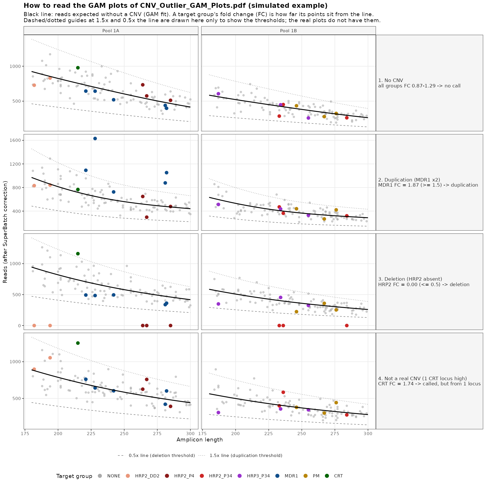

# CNV estimation: post-analysis

`estCNV_PostAnalysis.qmd` takes the per-gene fold changes produced by [`estCNV.qmd`] and links them to sample metadata and parasitemia. For each sample it keeps one sequencing run and adds the read depth
The code generates plots fold changes per gene and, if you choose, compares them between groups (e.g. regions). Finally, it lists the samples that pass the deletion and duplication thresholds

## Prerequisites

1. **Run `estCNV.qmd` first.** The post-analysis reads its final output, `fold_changes_final_output.csv`, and the same allele tables it used.
3. **R packages**:
   - `tidyverse`, `readxl`, `knitr`, `rmarkdown`, `mgcv` (always needed; `mgcv` comes with R)
   - `rstatix`, `ggpubr` (only needed when `location = TRUE`)
   - `Biostrings`, `pwalign` (Bioconductor; point mutations in CRT and MDR1)

```r
install.packages(c("tidyverse", "readxl", "knitr", "rmarkdown", "rstatix", "ggpubr", "BiocManager"))
BiocManager::install(c("Biostrings", "pwalign"))
```

## Inputs

### 1. Fold changes (`fold.changes.path`)

The `fold_changes_final_output.csv` file written by `estCNV.qmd`. It has one row per sample, run and gene:

| Column           | Description                               |
|------------------|-------------------------------------------|
| `sample_name`    | Sample identifier                         |
| `Run`            | Sequencing run                            |
| `gene`           | Gene (e.g. `CRT`, `HRP2`, `HRP3`, `MDR1`, `PM`) |
| `FoldChangeGene` | Per-gene fold change                      |

### 2. Allele tables (`allele.data.path`)

The folder that holds the allele tables used in `estCNV.qmd`. The script searches it recursively for files whose names start with `allele_data` or `allele_table`. Each file needs these columns:

- a sample ID column
- `reads`
- `target_name` or `locus`

If a file has no `Run` column, the name of its parent folder is used as the run. Sample names are cleaned (suffixes such as `_S12` and `_L001` are removed)

The allele tables are used for two things:

- **Run selection**: when a sample passed QC in more than one run, the run with more total reads is kept
- **Read depth**: the depth columns and plots described in [Workflow overview](#workflow-overview)

### 3. Metadata (`metadata.path`)

A CSV, TSV/TXT or Excel (`.xlsx`) file with **one row per sample**. It must have a sample ID column and contain parasitemia and location information. If `location = TRUE`, it must also have the grouping column named in `location.variable` 

### 4. Panel information (`panel.info.dir`)
The information for panel information and target reads can be found at:  https://github.com/EPPIcenter/copy-number-variation

The `panel_information/` folder bundled with the repository:

```
panel_information/
├── validated_target_filter.tsv   # Validated loci, used for the all-loci read depth
├── targets_of_interest.tsv       # target_name and group, used for the per-gene read depth
├── D1.1/
│   └── D1.1_amplicon_info.tsv    # Maps amplicon coordinates (locus) to target_name
└── ...
```

In `targets_of_interest.tsv`, groups are collapsed to their gene by dropping everything after the first `_`. For example, `HRP2_P4`, `HRP2_DD2` and `HRP2_P34` all become `HRP2`.

### 5. Reference sequences (no file needed)

The 3D7 mRNA and protein of CRT and MDR1 (NCBI RefSeq) are included in `estCNV_PostAnalysis.qmd`, in FASTA format, in the chunk `reference-sequences` of the section *Point mutations in CRT and MDR1*:

| Gene | Records |
|------|---------|
| CRT | XM_001348968.2 (mRNA), XP_001349004.1 (protein, 424 aa) |
| MDR1 | XM_001351751.2 (mRNA), XP_001351787.1 (protein, 1419 aa) |

The coding sequence is the part of the mRNA that translates into the protein. The script stops if no part of the mRNA does. The ASVs of the CRT and MDR1 outlier samples are aligned to the coding sequence and translated, to report the amino acid at CRT 97 and MDR1 86 (`mutation.codons`). The ASVs come from the allele tables, so these need an `asv` column and a pseudo-CIGAR column (`pseudocigar_unmasked` or `pseudo_cigar`).

## Sample ID matching

The script looks for the sample ID column in each table. Column names are matched case-insensitively, and the first match in the order below is used:

| Table                          | Recognised ID columns |
|--------------------------------|-----------------------|
| Fold changes, allele tables    | `sample_name`, `sampleID`, `sample_id`, `NIDA` |
| Metadata, parasitemia          | `NIDA`, `sample_name`, `sampleID`, `sample_id` |

Before matching, NIDA-style IDs are converted to a common form:

The report prints how many sample-runs matched the metadata and lists those that did not. Unmatched samples are left out of the analysis. Controls are recognised by `control.pattern` and are always left out of plots, tests and exports.

## Configuration

Edit the **Prepare Inputs** chunk at the top of `estCNV_PostAnalysis.qmd`:

```r
fold.changes.path = "/path/to/fold_changes_final_output.csv"
fold.changes.groups.path = "/path/to/fold_changes_output.csv"   # Fold changes per target group, written by estCNV.qmd
allele.data.path = "/path/to/allele_tables/"
target.counts.path = "/path/to/target_counts_corrected.csv"   # Written by estCNV.qmd; GAM plots are skipped without it
metadata.path = "/path/to/metadata.txt"
parasitemia.path = "/path/to/parasitemia_db.txt"
output.dir = "/path/to/output/"           # Created if it does not exist
```

| Parameter | Example | Description |
|-----------|---------|-------------|
| `location` | `TRUE` | Run the **Plots by Region or other** section (`TRUE`) or skip it (`FALSE`). |
| `location.variable` | `"region"` | Metadata column used to group samples, matched case-insensitively (e.g. `"region"`, `"district"`, `"us"`). Its values are treated as categories. |
| `location.order` | `c("North", "Centre", "South")` | Optional order of the groups on the plots. Values not listed follow in alphabetical order. |
| `parasitemia.decimal.mark` | `","` | Decimal separator used in `parasitemia.path`. |
| `parasitemia.extreme` | `1e9` | In the per-gene parasitemia plot, points above this value are drawn in navy. They are still used in the regression. |
| `control.pattern` | `"3D7\|Dd2\|HB3\|PM2"` | Regular expression (case-insensitive) that identifies control samples by name. |
| `expected.cnv` | see the file | Expected CNV per gene, drawn as a dotted line in the group boxplots. `duplication` is drawn at fold change 2, `deletion` at 0. |
| `gene.colors` | see the file | One color per gene. Every gene in the fold-change file needs a color, otherwise the script stops. |
| `mutation.codons` | CRT 97, MDR1 86 | Codon (amino acid position) checked in each gene. One codon per gene; each gene needs its 3D7 sequences in the `reference-sequences` chunk. |


## Outputs

All files are written to `output.dir`.

| File | Description |
|------|-------------|
| `fold_changes_final_metadata.txt` | One row per sample and gene for the selected run, with metadata, parasitemia and read-depth columns. Controls are excluded. |
| `CNV_ReadDepth_PerGene.txt` | Per-gene locus depth and all-loci depth for each sample and run, with the number of amplicons used and the number that had reads. |
| `CNV_Boxplots_FoldChange_PerGene.pdf` | Fold change per gene, all samples pooled. |
| `CNV_FoldChange_Parasitemia_PerGene.pdf` | Fold change against parasitemia (log10), per gene. |
| `CNV_FoldChange_AllLociReadDepth_PerGene.pdf` | Fold change against mean reads across all validated loci, per gene. |
| `CNV_FoldChange_ReadDepth_PerGene.pdf` | Fold change against mean reads across the gene's targets of interest. |
| `CNV_Outlier_Summary.txt` | Samples and genes that pass the deletion or duplication thresholds. An HRP2 deletion (called on the gene fold change) is given as three rows, `HRP2_DD2`, `HRP2_P34` and `HRP2_P4`, each with the fold change of the group from `fold_changes_output.csv`. Columns: `SampleID`, `FoldChange`, `Gene`, `GeneReads`, `GeneReadCoverage` (mean reads per locus of the gene, or of the group in the HRP2 rows), `SampleTotalReads`, `Parasitemia`, `Type`, `CodonAA_Alt/Ref`, `CodonNuc_Alt/Ref`, then the original metadata columns. `CodonAA_Alt/Ref` (amino acid at CRT 97 or MDR1 86 in the sample / in 3D7 with its position, e.g. `H/H97` or `Y/H97`, `N/N86` or `Y/N86`; `?` means it could not be read because of an indel) and `CodonNuc_Alt/Ref` (codon nucleotides in the sample / in 3D7, e.g. `CAC/CAC` or `TAC/CAC`) are filled in the CRT and MDR1 rows only, with one entry per ASV covering the codon, separated by `; ` and ordered by reads. The HTML report also lists each ASV with its reads and pseudo-CIGAR. |
| `CNV_Outlier_GAM_Plots.pdf` | One page per sample and run of `CNV_Outlier_Summary.txt`: reads per locus (after the SuperBatch correction) against amplicon length, colored by target group, with the GAM fit of `estCNV.qmd` per pool, the threshold call(s) and the fold change of each target group. Needs `target_counts_corrected.csv`, written by `estCNV.qmd`. See [Reading the GAM plots](#reading-the-gam-plots). |

When `location = TRUE`, three more files are written. Their names end with `location.variable` (e.g. `_region`):

| File | Description |
|------|-------------|
| `CNV_Tests_<variable>.txt` | Dunn's test for each pair of groups within each gene, with the group medians and the gene's Kruskal–Wallis result. |
| `CNV_Boxplots_FoldChange_<variable>.pdf` | Fold change per gene and group, with Dunn p-values. |
| `CNV_Regression_FoldChange_Parasitemia_<variable>.pdf` | Fold change against log10(parasitemia), per gene and group. |

## Reading the GAM plots

Each page of `CNV_Outlier_GAM_Plots.pdf` shows one sample, with one panel per pool. Every point is a locus: its reads (after the SuperBatch correction) against its amplicon length. The black line is the GAM fit of `estCNV.qmd`, the reads expected at each length when there is no CNV. Gray points are the background loci used to fit it, and colored points are the targets of interest. A target group's fold change is how far its points sit from the line: 1 on the line, 2 at twice the line, 0 at zero reads. The thresholds are a fold change of at least 1.5 for a duplication (CRT, MDR1, PM) and at most 0.5 for a deletion (HRP2, HRP3).

The figure below uses simulated data with the same model and colors. The dotted and dashed lines at 1.5× and 0.5× the black line are drawn here only to show the thresholds; the real plots do not have them.



| Row | What the plot shows | Call |
|-----|---------------------|------|
| 1. No CNV | All colored points sit inside the gray cloud, close to the line. | None: all fold changes between 0.87 and 1.29. |
| 2. Duplication | The MDR1 points (dark blue) sit above the line, most of them around 1.5× or higher. | Duplication: MDR1 fold change 1.87. |
| 3. Deletion | All HRP2 points (red tones) sit at 0 reads, in both pools. | Deletion: HRP2 fold change 0.00. |
| 4. Not a real CNV | Only the single CRT locus (green) is high; every other point is on the line. | Duplication called (CRT fold change 1.74), but it rests on one locus. |

When checking a call:

- **A real CNV moves the whole group.** All loci of the group shift together, in every pool where the group has loci. Single loci still scatter around 2× or 0; that is normal.
- **A group with one locus is weak evidence.** One locus can sit far from the line by chance: in row 1, with no CNV simulated, the CRT locus has fold change 1.29. Treat calls from a single locus with caution.
- **Mixed infections fall in between.** When only some of the parasites carry a deletion, the group's points sit between 0 and the line (e.g. around 0.5×) instead of at 0.
